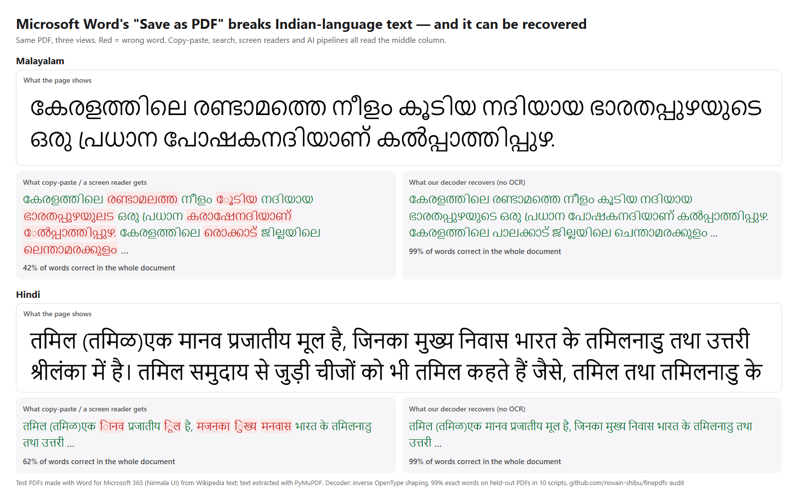

# FinePDFs audit: corrupted and fabricated complex-script text

Same PDF (made with Word for Microsoft 365), three views. Red = wrong word. Copy-paste, search, screen readers and AI pipelines all read the middle column. Text excerpts: Malayalam and Hindi Wikipedia, CC BY-SA 4.0; the image is CC BY-SA 4.0.

**Check your own PDFs:** `pip install git+https://github.com/novain-shibu/indic-pdf-check` then `indic-pdf-check file.pdf` -> `OK` / `BROKEN` / `NO_TEXT` / `INSUFFICIENT_TEXT` / `UNSUPPORTED_SCRIPT` for Indian, Sinhala, Thai, Lao, Khmer, Myanmar and Thaana scripts ([indic-pdf-check](https://github.com/novain-shibu/indic-pdf-check)).

**Recover the text (no OCR):** [Unshape](https://github.com/novain-shibu/unshape), open source (AGPL-3.0 or commercial licence): `pip install git+https://github.com/novain-shibu/unshape` then `unshape file.pdf --font <the document's original font>`.

An audit of the complex-script configs of [HuggingFaceFW/finepdfs](https://huggingface.co/datasets/HuggingFaceFW/finepdfs).
Full report: **[REPORT.md](REPORT.md)**.

## Findings in short
1. **Text-layer (Docling) path:** 3-29% (most 9-21%) of words are orthographically impossible in 16 complex-script
   configs, vs 0.00-0.55% in Wikipedia; roughly 300k documents with > 5% such words in the sampled configs.
2. **Root cause:** mostly the PDFs themselves; in 18 of 24 originals the text layer itself is broken, 19 of 24 were made
   with Microsoft Word, and Word for
   Microsoft 365 with its own font (Nirmala UI) exports PDFs from which only 7-65% of words can be read back.
3. **rolmOCR path:** the stored text of random documents almost never matches an independent OCR of the same PDF in
   7 scripts (Malayalam 18/18, Telugu 17/17, Kannada 17/17, Tamil 6/7, Sinhala 15/15, Odia 19/19, Punjabi 14/16 below a
   pre-set threshold; Hindi, Bengali, Marathi, Nepali, Gujarati 0 and Thai 3/17). Hand-checked examples are fluent-looking
   but say something other than what the page says. Roughly 4.8 billion tokens if the sampled rates hold (a rough extrapolation that counts all tokens of flagged documents; disagreement with a second OCR is a strong signal, not proof for every document).
   Consistent with GlotOCR Bench (arXiv 2604.12978).
4. **Recovery without OCR:** inverting OpenType shaping recovers 99.1% of words on held-out Word PDFs in 10 scripts
   (free Tesseract: 86.2%). Released as [Unshape v0.2](https://github.com/novain-shibu/unshape) (DOI 10.5281/zenodo.23418945).
5. **New in v1.2, "Gilaki" config:** 84% of a fresh random sample of `glk_Arab` (4.98B tokens) is broken Persian/Arabic
   PDF text labelled Gilaki (CI 76-90%; clean controls 0/104 and 0/40); about 4.5B tokens if the rate holds (rough extrapolation).
6. **New in v1.3, small languages get the broken text:** across 82 non-Latin configs, Southern Balochi (99%), Kashmiri (94%),
   Gilaki (73%) and Mesopotamian Arabic (69%) are mostly broken Persian/Arabic; Assamese, Uyghur and Punjabi are mostly
   broken text in their own language. About 6.1B mislabelled tokens if the sampled rates hold (rough extrapolation, all tokens of flagged documents).
7. **New in v1.4, government PDFs:** 93.8% of 791 sampled Indian government regional-language PDFs have no correct text (73% had no usable text layer and
   were sent to OCR - in a check of 9, 8 had no text at all; 21% garbled text layers, mostly Word-made in a checked subset; 6% clean);
   no improvement between 2017-19 and 2023-25 crawls. A conditional audit of PDFs that Common Crawl captured and FinePDFs kept.
8. **New in v1.4 (corrected in v1.5), a cause - Word's Save as PDF:** same text, same font: Edge loses no letters (a few doubled vowel signs; letter F1
   97-99.5%), Word 365 loses and garbles them (letter F1 34-90%: Khmer, Myanmar, Malayalam, Hindi); it also garbles Divehi and Lao (Arabic, Hebrew, Thai fine). Free checker: `tools/indic_pdf_check.py`.

## What is in this repository
- `REPORT.md` - the report (numbers, method, limits).
- `code/` - every script used: sampling and orthographic check (`validity.py`, `random_sample.py`, `analyze_random.py`),
  original-PDF fetch (`fetch_originals.py`, `fetch_bulk.py`, `fetch_ocrpath.py`), the two-reader fabrication check
  (`score26.py`, `skeptic26.py`, `anchors26.py`, `kaggle/tesseract_finepdfs_ocrpath.py`), the Gilaki check
  (`gilaki_check.py`), the small-language sweep (`exile_check.py`), the government-PDF sample (`gov_check.py`), the Word
  cross-script test (`word_scripts_test.py`) and Word-vs-Edge control (`word_vs_edge_test.py`, Windows + Word + Edge), and the PDF checker (`../tools/indic_pdf_check.py`), test-data generation
  (`make_data.py`, `fresh2_data.py`, `word_var.ps1`), OCR baselines (`kaggle/`) and scorers; shared helpers in
  `common.py`. Research code: paths assume the original working layout.
- The recovery decoder (section 4 of the report) is released separately as
  [Unshape v0.2.0](https://github.com/novain-shibu/unshape) (AGPL-3.0 or commercial licence; DOI 10.5281/zenodo.23470282).
- `results/` - raw result files (document IDs and numbers only), hand labels written before automatic scores
  (`labels26.json`), and the SHA-256 of each frozen decoder version.

## What is NOT in this repository (on purpose)
No PDFs, page images, fonts, Wikipedia text or FinePDFs document text are redistributed (the one exception is the demo image above: two lines of Wikipedia text in our own test PDF, CC BY-SA 4.0). Every result names FinePDFs
document IDs, so anyone can fetch the same originals from Common Crawl (FinePDFs records the WARC path and offset) and
the stored text from the dataset itself.

## Data sources and licences
FinePDFs (ODC-By 1.0); original PDFs via Common Crawl (Common Crawl terms of use); Wikipedia text (CC BY-SA 4.0) used
only locally to generate test PDFs; Windows system fonts used locally only. Code: Apache-2.0 (`LICENSE`). Report text and
result files: CC BY 4.0.

## AI assistance
Analysis, code and write-up were produced with an AI assistant (Claude); numbers were re-derived from raw files.

## Citation
See `CITATION.cff`. Author: Novain Shibu - georgeshibu380@gmail.com - github.com/novain-shibu - linkedin.com/in/novain-shibu
